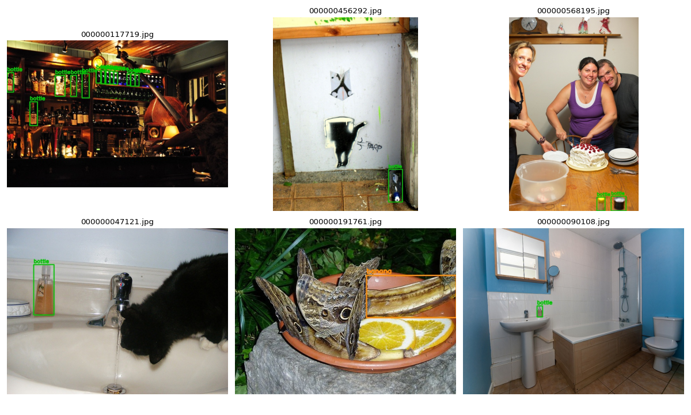
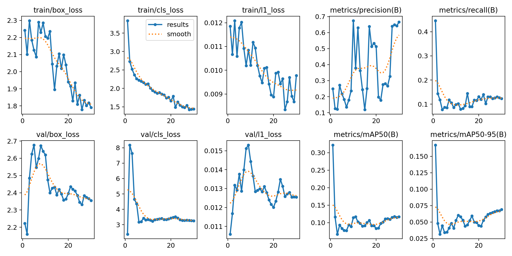
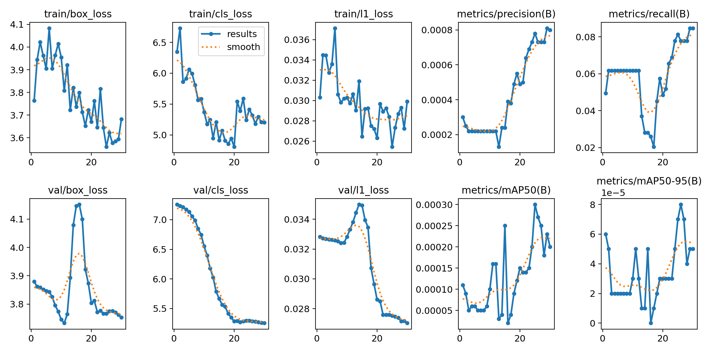
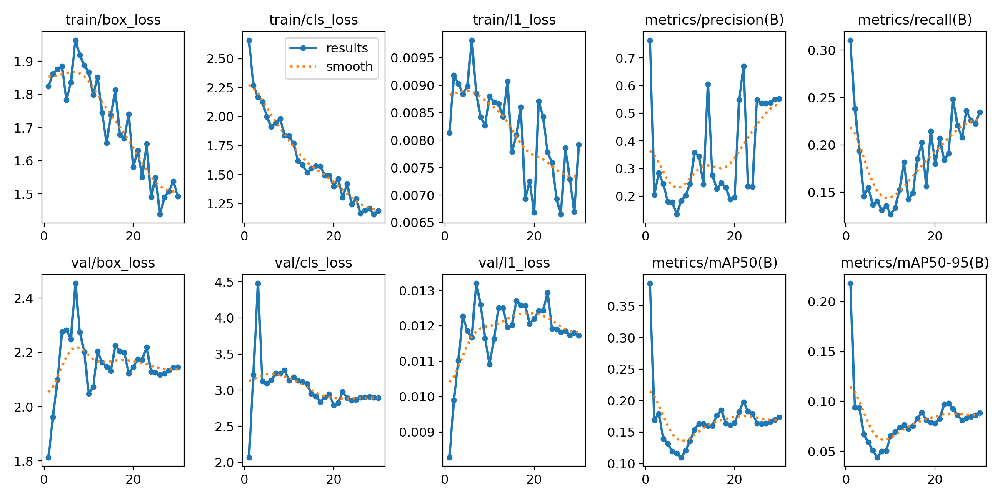
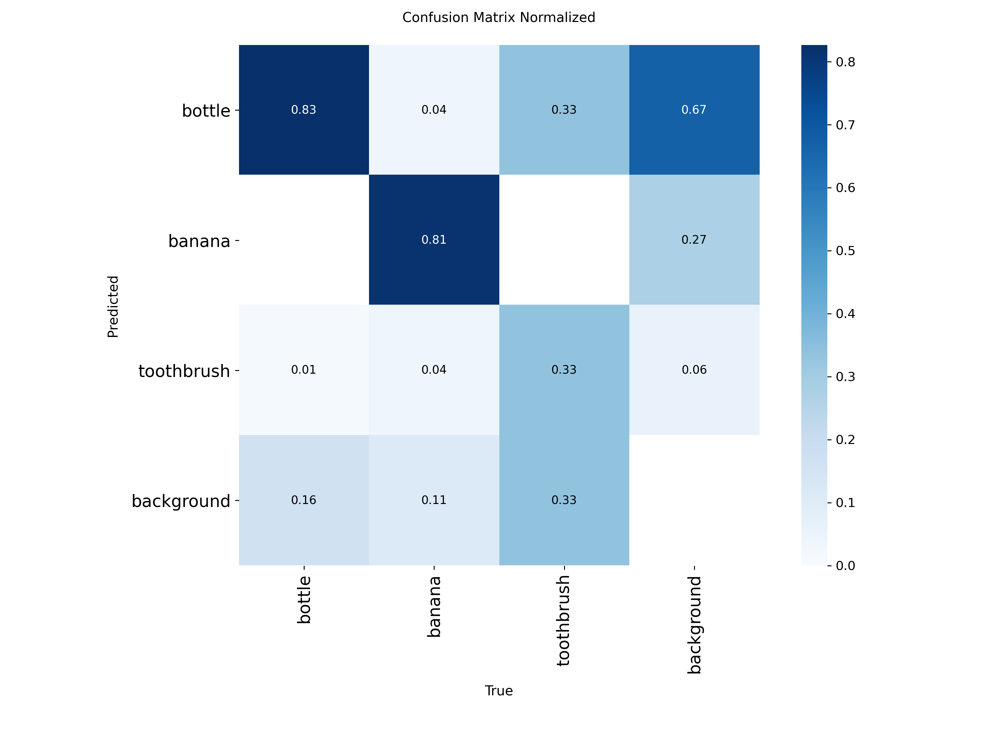
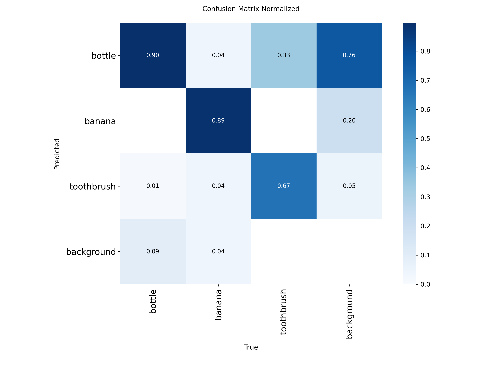

# PJ1 RET503 – Data dan Model YOLO untuk Robot Pemilah Sampah

Laporan tugas PJ1 (minggu 4–7) mata kuliah **RET503 Computer Vision and Deep Learning**.
Praktik terpadu "Dari COCO ke detektor YOLO" dengan tiga kelas COCO yang dipilih sesuai misi robot pemilah sampah.

## 1. Identitas

| | |
|---|---|
| Nama | Lalu Juanda Renaldy |
| NIM | 4222411043 |
| Kelas | TRR Malam B |
| Program studi | Teknologi Rekayasa Robotika, Politeknik Negeri Batam |
| Mata kuliah | RET503 Computer Vision and Deep Learning (semester 5) |
| Jenis tugas | Individu |
| Projek robot | Robot konveyor pemilah sampah dengan kamera |

**Sidik jari dataset** (dicetak otomatis oleh `06_latih_bandingkan.py`):

```
Dataset       : dataset_v1  (sidik jari label: 3262B29C99F5)
Waktu         : 16-10-2026 10:08:45 (jam server Colab, UTC = 17:08 WIB)
Komputer/user : 4e360cef27ca / root  (Google Colab, GPU Tesla T4)
Pengaturan    : model yolo26n, epochs 30, imgsz 416, batch 16
```

## 2. Lingkup persepsi (dari misi projek)

Misi robot: sampah berjalan di atas konveyor, kamera mendeteksi jenisnya, lalu sampah diarahkan ke salah satu bin di ujung konveyor. Untuk praktik ini dipilih tiga kelas COCO yang mewakili tiga bin:

| class_id | Kelas COCO | Bin di robot | Alasan |
|---|---|---|---|
| 0 | `bottle` | Anorganik **dapat didaur ulang** | botol adalah sampah daur ulang yang paling umum |
| 1 | `banana` | **Organik** | sisa buah mewakili sampah yang bisa dikomposkan |
| 2 | `toothbrush` | Anorganik **residu** | plastik campuran, sulit didaur ulang; sekaligus **kelas jarang** di COCO |

Yang **tidak** termasuk lingkup: objek selain tiga kelas di atas (dianggap latar), sampah yang menumpuk atau saling menutupi, serta klasifikasi bahan (misalnya botol plastik vs kaca; COCO hanya punya satu kelas `bottle`).

## 3. Target kinerja

Kecepatan konveyor dan tinggi kamera belum ditetapkan. Target berikut memakai **asumsi** yang ditandai, dan akan diperbarui setelah rancangan mekanik final.

| Metrik | Target | Alasan |
|---|---|---|
| mAP50 (val) | ≥ 0,70 | setiap salah pilah berarti sampah masuk bin yang salah; angka 0,70 dipakai sebagai batas awal prototipe |
| AP50 per kelas | ≥ 0,60 untuk **setiap** kelas | rata-rata yang tinggi tidak cukup jika satu bin (misal residu) selalu gagal |
| Kecepatan | ≥ 10 FPS di laptop | *asumsi* konveyor ±5 cm/detik dan area pandang ±20 cm → objek terlihat ±4 detik; 10 FPS memberi puluhan kesempatan deteksi per objek |
| Latensi kamera → keputusan | ≤ 200 ms | pada 5 cm/detik objek hanya bergeser ±1 cm sebelum perintah ke aktuator dikirim |

Prioritas: **recall** (tidak ada sampah yang terlewat tanpa dipilah) sedikit lebih penting daripada precision, karena sampah yang tidak terdeteksi akan jatuh tanpa dipilah.

## 4. Rancangan pipeline

| Komponen | Rancangan |
|---|---|
| Kamera | kamera bawaan laptop (belum ada kamera terpisah) |
| Posisi | laptop diletakkan di sisi/ujung konveyor, layar dimiringkan agar kamera melihat area deteksi di atas sabuk; tinggi kamera belum ditetapkan |
| Perangkat pemroses | laptop (CPU, tanpa GPU khusus – *asumsi*) |
| Model | YOLO26n hasil `E3_tuning` (`best.pt`, imgsz 640) |

Alur per frame:

```
kamera laptop (OpenCV, 640x480)
  -> YOLO26n best.pt  (kotak + kelas + confidence)
  -> filter: confidence >= 0,5 dan kotak berada di zona deteksi (ROI) di atas sabuk
  -> pilih deteksi dengan confidence tertinggi
  -> keputusan bin: bottle = daur ulang, banana = organik, toothbrush = residu
  -> perintah ke pengendali aktuator/pemilah (misal lewat serial – rancangan)
```

Catatan risiko: kamera bawaan laptop menghadap ke depan, bukan ke bawah, sehingga sudut pandangnya miring dan latarnya berubah-ubah. Ini berbeda dengan foto COCO (adegan sehari-hari), jadi model perlu dilatih ulang dengan foto dari konveyor sendiri (lihat bagian 9).

## 5. Dataset dan hasil cek anotasi

Dibuat dengan `00_ambil_subset_coco.py --kelas bottle banana toothbrush --jumlah 200` dari COCO val2017.

| | bottle | banana | toothbrush | Total |
|---|---|---|---|---|
| Jumlah kotak (semua) | 412 | 163 | 33 | 608 |
| Rasio terhadap toothbrush | 12,5× | 4,9× | 1× | |

- Gambar: 220 (200 berobjek + 20 gambar latar tanpa objek).
- `01_cek_anotasi.py`: **0** gambar tanpa label, **20** label kosong (sesuai jumlah gambar latar), **40 kotak (±6,6%) berukuran < 8 px**. Ini objek nyata yang sangat kecil (misalnya deretan botol di rak bar), bukan kesalahan format, sehingga **dibiarkan**.
- Cek visual: kotak dan nama kelas cocok dengan objeknya. Ditemukan juga botol di rak yang **tidak dilabeli** oleh COCO (gambar 000000117719).
- Uji konversi dua arah (`02_yolo_ke_coco.py` → `03_coco_ke_yolo.py`): 220 gambar dan 608 kotak; **220/220 file label identik**, selisih koordinat maksimum 0,000000.



**Pembagian data** (`05_split_dataset_yolo.py`, seed 42):

| Split | Gambar | bottle | banana | toothbrush |
|---|---|---|---|---|
| train | 154 | 275 | 117 | 29 |
| val | 44 | 98 | 27 | **3** |
| test | 22 | 39 | 19 | **1** |

Augmentasi: memakai bawaan Ultralytics (mosaic, fliplr 0,5, hsv, scale 0,5). Flip atas-bawah dan rotasi besar tidak diaktifkan, karena botol dan sampah di konveyor tidak muncul terbalik dari sudut kamera tetap.

## 6. Hasil eksperimen E1 / E2 / E3 (data val)

Keluaran asli `hasil_praktik_4222411043.txt`:

| Eksperimen | Perubahan | mAP50 | mAP50-95 | Precision | Recall | Inferensi (ms/gambar, T4) | Waktu latih (menit) |
|---|---|---|---|---|---|---|---|
| E1_pretrained | – (baseline, `yolo26n.pt`) | 0,330 | 0,167 | 0,238 | 0,440 | 7,4 | 1,8 |
| E2_scratch | bobot acak (`yolo26n.yaml`) | 0,000 | 0,000 | 0,001 | 0,078 | 4,3 | 1,5 |
| E3_tuning | `imgsz=640` | **0,378** | **0,219** | 0,769 | 0,307 | 10,0 | 1,9 |

**Model terpilih (mAP50-95 val tertinggi): E3_tuning.**

### Hasil di data TEST (sekali saja)

| Model | mAP50 | mAP50-95 |
|---|---|---|
| E3_tuning | **0,823** | **0,630** |

## 7. AP per kelas

Dari `ap_per_kelas_4222411043.csv`:

| Eksperimen | Split | Kelas | Jumlah kotak | AP50 | AP50-95 |
|---|---|---|---|---|---|
| E1_pretrained | val | bottle | 98 | 0,328 | 0,138 |
| E1_pretrained | val | banana | 27 | 0,394 | 0,229 |
| E1_pretrained | val | toothbrush | 3 | 0,266 | 0,136 |
| E3_tuning | val | bottle | 98 | 0,477 | 0,281 |
| E3_tuning | val | banana | 27 | 0,490 | 0,309 |
| E3_tuning | val | toothbrush | 3 | 0,166 | 0,066 |
| E3_tuning | test | bottle | 39 | 0,734 | 0,533 |
| E3_tuning | test | banana | 19 | 0,739 | 0,463 |
| E3_tuning | test | toothbrush | 1 | 0,995 | 0,896 |

## 8. Grafik

### E1_pretrained


### E2_scratch


### E3_tuning


### Confusion matrix (dinormalisasi)
| E1_pretrained | E3_tuning |
|---|---|
|  |  |

## 9. Analisis

### 9.1 E1 vs E2: transfer learning
E1 (bobot pretrained COCO) mencapai mAP50-95 val 0,167, sedangkan E2 (bobot acak) 0,000 dengan data, epoch, ukuran input, dan seed yang sama. Pada E2, `val/cls_loss` turun mulus dari 7,26 ke 5,25 dan `train/cls_loss` dari 6,35 ke 5,20, jadi model **sedang belajar**. Tetapi 30 epoch dengan 154 gambar jauh dari cukup untuk belajar mengenali objek dari nol. Backbone pretrained sudah membawa pengetahuan tepi, tekstur, dan bentuk dari COCO, sehingga E1 langsung bisa mendeteksi. Ini bukti manfaat transfer learning untuk dataset kecil.

### 9.2 E1 vs E3: tuning (imgsz 416 → 640)
mAP50-95 val naik dari 0,167 ke 0,219 (+31%) dan mAP50 dari 0,330 ke 0,378. Kenaikan terbesar ada di **bottle** (AP50-95 0,138 → 0,281, naik 2×). Ini cocok dengan hasil cek anotasi: banyak botol berukuran kecil, dan gambar input yang lebih besar membuat objek kecil lebih terlihat. Harganya, inferensi lebih lambat (7,4 → 10,0 ms/gambar di T4, +35%). Precision naik (0,238 → 0,769) tetapi recall turun (0,440 → 0,307). **Kesimpulan: perubahan dipertahankan**, karena akurasi naik dan inferensi masih jauh di bawah anggaran latensi. Namun recall yang turun bertentangan dengan prioritas robot, jadi perlu diperhatikan.

### 9.3 Membaca kurva loss dan mAP
- **Model terbaik ada di epoch 1.** Di `results.csv`, mAP50-95 val E1 tertinggi di epoch 1 (0,167), lalu anjlok ke 0,048 (epoch 2) dan 0,032 (epoch 3), dan hanya pulih ke 0,069 di epoch 30. Pola E3 sama: 0,218 di epoch 1, lalu 0,094, dan 0,088 di epoch 30. Jadi `best.pt` E1 dan E3 adalah **bobot epoch 1**, bukan hasil 30 epoch.
- Di saat yang sama, `val/cls_loss` E1 melonjak dari 2,38 (epoch 1) ke 8,17 (epoch 2), lalu turun pelan ke 3,25 di epoch 30, tetapi tidak pernah kembali serendah epoch 1. Lonjakan ini terjadi saat learning rate naik selama warmup (0,00043 → 0,00088 → 0,00129; `optimizer=auto` memilih learning rate sendiri dan mengabaikan `lr0=0.01`).
- **Dugaan penyebab:** bottle, banana, dan toothbrush adalah kelas asli COCO. Dengan `cls_remap=True` (tercatat di `args.yaml`), pengetahuan kelas dari model pretrained diduga ikut dipakai sejak awal, sehingga epoch 1 sudah bagus. Setelah seluruh bobot ikut dilatih ulang dengan hanya 154 gambar, pengetahuan itu terganggu (*catastrophic forgetting*), dan 300 langkah latih (30 epoch × 10 batch) belum cukup untuk memulihkannya. Ini dugaan dari log, belum dibuktikan dengan eksperimen.
- Di sisi train, `train/cls_loss` E1 turun terus (3,84 → 1,44) sedangkan `val/cls_loss` di akhir masih 3,25. Selisih ini menunjukkan model mulai **menghafal data train** yang kecil.

### 9.4 Ketidakseimbangan kelas
Rasio kotak 412 : 163 : 33 (bottle 12,5× toothbrush). Dampaknya terlihat dua kali:
1. **Sulit dipelajari.** Hanya ada 29 toothbrush di train. AP50-95 toothbrush di val turun dari 0,136 (E1) ke 0,066 (E3), satu-satunya kelas yang memburuk.
2. **Sulit dinilai.** Di val hanya ada **3** toothbrush dan di test hanya **1**. Satu deteksi benar atau salah langsung mengubah AP secara ekstrem, jadi angka toothbrush **tidak dapat dipercaya** secara statistik.

Confusion matrix menunjukkan kesalahan utama **bukan** salah tukar antar-kelas. Masalah terbesarnya adalah **deteksi palsu yang hampir selalu ditebak "bottle"** (76% deteksi pada area latar di E3 berlabel bottle). Sebagian kemungkinan berasal dari benda mirip botol (gelas, kaleng, vas), dan sebagian lagi dari botol asli yang tidak dilabeli COCO (lihat cek visual). Diagonal confusion matrix (bottle 0,90, banana 0,89) lebih tinggi daripada recall di tabel (0,307), karena keduanya kemungkinan dihitung pada ambang confidence yang berbeda. Jadi angka keduanya tidak dibandingkan langsung.

### 9.5 Hasil test
mAP50-95 test (0,630) jauh lebih tinggi daripada val (0,219). Penyebabnya:
- test hanya 22 gambar / 59 kotak, sehingga sangat dipengaruhi kebetulan;
- toothbrush di test hanya 1 kotak dengan AP50-95 0,896, yang mendongkrak rata-rata. Tanpa toothbrush, rata-rata bottle dan banana adalah 0,498, masih lebih tinggi daripada val;
- model terpilih praktis adalah model pretrained setelah 1 epoch, jadi angkanya lebih mencerminkan pengetahuan COCO daripada hasil training.

Kesimpulannya, angka test ini **dilaporkan apa adanya** (test dipakai sekali, sesuai aturan), tetapi **tidak boleh dianggap kinerja nyata robot**. Dibutuhkan test set yang jauh lebih besar dan foto dari konveyor sendiri.

## 10. Kesimpulan

1. Transfer learning terbukti penting: pretrained 0,167 vs dari nol 0,000 (mAP50-95 val).
2. Tuning `imgsz=640` menaikkan mAP50-95 val 31%, terutama untuk botol kecil, dengan biaya inferensi +35%. Perubahan dipertahankan.
3. Target kinerja **belum tercapai**: mAP50 val 0,378 (target ≥ 0,70) dan AP toothbrush jauh di bawah 0,60. Kecepatan di laptop **belum diukur**. Yang terukur hanya inferensi di GPU T4 (10,0 ms, setara ±100 FPS untuk inferensi saja).
4. Masalah terbesar: kelas minoritas (toothbrush) terlalu sedikit, deteksi palsu "bottle", dan model terbaik sudah tercapai di epoch 1.

## 11. Eksperimen berikutnya

Satu perubahan per eksperimen, dibandingkan dengan E3 sebagai baseline baru:

| Usulan | Perubahan | Alasan |
|---|---|---|
| E4 | `freeze=10` (bekukan backbone) | mencegah pengetahuan COCO rusak di awal training |
| E5 | `optimizer=SGD lr0=0.001` | learning rate kecil dan eksplisit, agar penurunan di epoch 2–3 tidak terjadi |
| E6 | dataset_v2: tambah gambar toothbrush (dari COCO train2017) | memperbaiki ketidakseimbangan dan membuat AP toothbrush bisa dipercaya |
| E7 | foto sendiri dari kamera laptop di atas konveyor | menyesuaikan dengan kondisi nyata robot |
| Uji kecepatan | jalankan `best.pt` di laptop dengan kamera | mengukur FPS dan latensi nyata terhadap target |

## 12. Isi repository

| File / folder | Isi |
|---|---|
| `README.md` | laporan ini |
| `PJ1_COCO_4222411043.ipynb` | notebook Colab yang dijalankan (memanggil program dosen tanpa mengubahnya) |
| `hasil_praktik_4222411043.txt` / `.csv` | keluaran asli `06_latih_bandingkan.py` |
| `ap_per_kelas_4222411043.csv` | AP per kelas (val E1, E3; test model terpilih) |
| `cek_visual_contoh.png` | contoh gambar dengan kotak dari `01_cek_anotasi.py` |
| `dataset_v1/data.yaml` | konfigurasi dataset |
| `hasil_praktik/E1_pretrained`, `E2_scratch`, `E3_tuning` | results.png, results.csv, confusion matrix, kurva PR/F1, args.yaml, contoh batch |

File besar (dataset_yolo, dataset_v1 lengkap, dan bobot `best.pt`/`last.pt`) ada di Google Drive:
**[lengkap_coco_4222411043.zip](https://drive.google.com/file/d/1jMTbVmH__EAYr4itBBuDYW5B9l7KlXQm/view?usp=drive_link)**
(folder lengkap: [RET503_PJ1](https://drive.google.com/drive/folders/1ibXhaSgECxqKpzZpxc8p7QYYjhxkEQzF?usp=sharing)).

Program dosen yang dipakai tanpa diubah: `00_ambil_subset_coco.py`, `01_cek_anotasi.py`, `02_yolo_ke_coco.py`, `03_coco_ke_yolo.py`, `05_split_dataset_yolo.py`, `06_latih_bandingkan.py`.

## 13. Referensi

1. Materi kuliah RET503 Minggu 4–7, "Dari Data ke Model YOLO", Politeknik Negeri Batam.
2. Lin, T.-Y. dkk., "Microsoft COCO: Common Objects in Context", ECCV 2014.
3. Redmon, J. dkk., "You Only Look Once: Unified, Real-Time Object Detection", CVPR 2016.
4. Ultralytics Docs, "COCO Dataset" dan "Train" (https://docs.ultralytics.com).
5. Ultralytics Academy, "Prepare a Custom Dataset".
